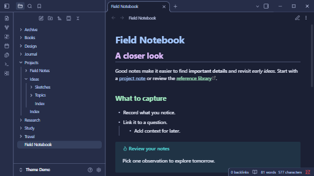
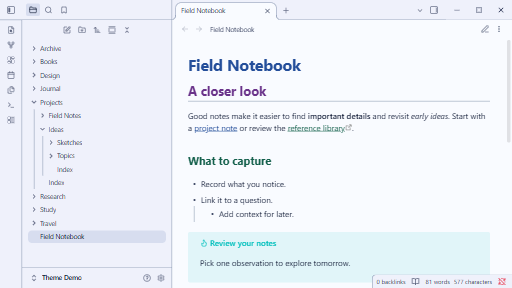

# Study Outline

An Obsidian theme with a clear heading hierarchy and easy-to-scan study notes. It supports light and dark modes and styles all six heading levels, list markers, and indentation guides.

Source version 3.6.2. The published 3.6.0 release was tested in Obsidian 1.15.1 on Windows. See the [UI test report](docs/ui-qa/2026-11-24/README.md) for the current source version.

## Preview

## Installation

Find **Study Outline** in the Community themes browser under **Settings > Appearance**, or install it manually.

1. Download `manifest.json` and `theme.css` from the [latest published release](https://github.com/tutivsoft-com/obsidian-theme-study-outline/releases/latest).
2. Put both files in `.obsidian/themes/Study Outline/` in your vault.
3. Open **Settings > Appearance** and select **Study Outline**. Choose light or dark mode.

## Source checks

Run `python test_theme.py -v` with `tinycss2` and `cssselect2` installed. The checks cover stylesheet syntax, heading sizes, list marker styling, palette contrast, version metadata and local README links.

See the [original design plan](PLAN.md) and the [MIT license](LICENSE).
